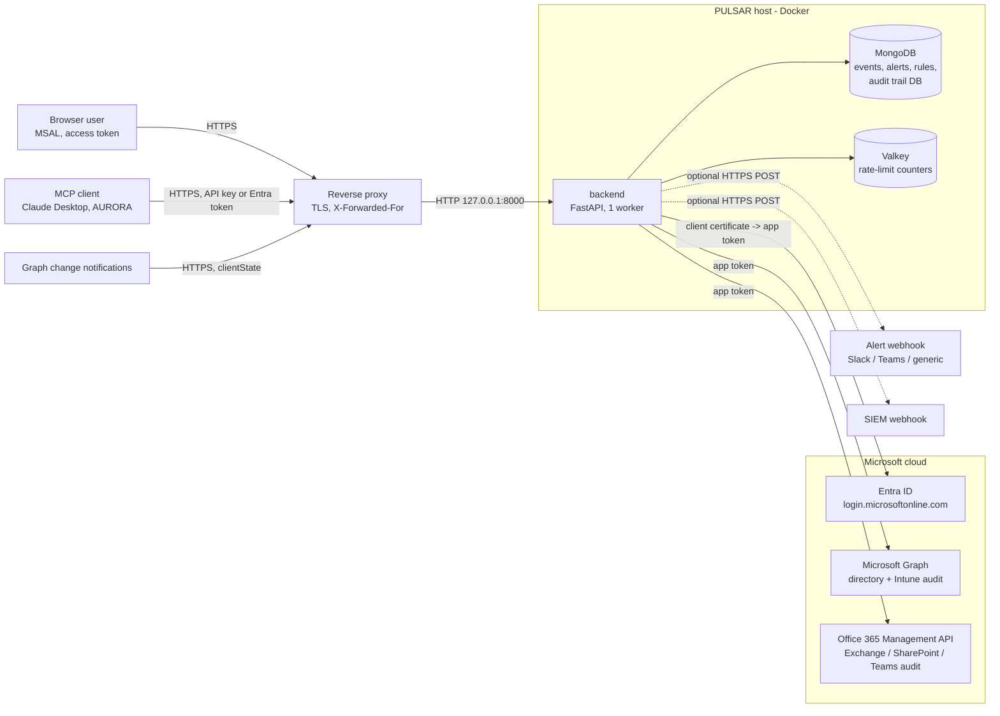

# PULSAR threat model

Scope: the PULSAR code and the reference deployment (`docker-compose.prod.yml` behind a TLS-terminating reverse
proxy). A deployment serves one tenant; there is no multi-tenant mode, so each client gets its own instance and data
store. The Azure Container Apps path ([DEPLOY-AZURE.md](../../DEPLOY-AZURE.md)) has weaker database isolation; see
[KI-13](known-issues.md#ki-13-azure-path-without-the-least-privilege-database-user---medium-open).

Weaknesses and limits we know about are listed with severities in [known-issues.md](known-issues.md); this document
refers to them by ID.

## 1. System and data flow

Trust boundaries: (1) internet to reverse proxy, (2) proxy to backend, (3) backend to data stores (internal network
only), (4) backend to Microsoft and to the two optional webhooks, (5) browser to its own page (the UI loads Alpine and
MSAL from two pinned CDN paths).

Two Entra app registrations keep the powerful credential away from the user-facing one:

- **Ingestion app** - application permissions `AuditLog.Read.All`, `DeviceManagementApps.Read.All`,
  `ActivityFeed.Read`; authenticates with a certificate whose private key never leaves the server; no redirect URIs.
- **API app** - defines app roles, requires assignment, has no credentials and no application permissions.

## 2. Assets

| Asset | Why it matters |
|---|---|
| Audit events (UPNs, IPs, device and group names, admin actions) | Personal data and a map of who administers the tenant |
| Ingestion certificate (key + cert) | Read access to the whole tenant's audit data |
| Audit trail of PULSAR itself | Accountability for what users did in PULSAR |
| Alert rules and webhook URLs | Altering them silences or redirects detection |
| MCP API key, webhook `clientState` | Direct read access / spoofed notifications |

## 3. STRIDE

| Threat | Where | Control | Evidence |
|---|---|---|---|
| **Spoofing** a user | API, UI, MCP | Entra access tokens only (RS256, JWKS, exact issuer, `tid`, audience, required `scp`, required `exp`/`iss`/`aud`); ID tokens rejected; assignment-required app | `test_security.py`: tenant/issuer, ID-token, required-claims tests |
| Spoofing Graph | `/api/webhooks/graph` | Constant-time `clientState` comparison; rejected when no secret is configured | `test_api.py` webhook tests |
| Spoofing a client IP | rate limit, `/metrics` | `X-Forwarded-For` read right to left, only through `TRUSTED_PROXIES`. The default trusts all private ranges (KI-04) | `test_security.py` XFF tests |
| **Tampering** with events | API | No API edits raw events; tag/comment writes are scoped by the privacy filter; rule changes are admin-only. Readers can annotate (KI-08); the app's DB user can modify events (KI-09) | route-authorisation test |
| Tampering with the audit trail | MongoDB | App user can only insert into the audit database; a copy goes to stdout first. Writes fail open (KI-10) | `deploy/mongo-init`, `audit_trail.py` |
| Tampering in transit | all links | TLS at the proxy; Microsoft calls over HTTPS with redirects disabled; SIEM HTTPS-only. No TLS to MongoDB/Valkey (KI-12) | [outbound-http-review.md](outbound-http-review.md) |
| **Repudiation** | mutations | One audit record per mutating request: user, action, detail, method, status, request ID (failed and denied attempts included) | `test_security.py` audit tests |
| **Information disclosure** | reads | Privacy-gated services/operations hidden at query level on every read path (REST, MCP, alerts, filter options, summaries); documents without a service are hidden too | `test_security.py` privacy tests |
| Disclosure via errors | API | Generic 500 handler; OpenAPI docs off; webhook and Office 365 errors do not echo upstream bodies | `main.py` |
| Disclosure via alert cards | Slack/Teams | Tenant-controlled names are defanged (`hxxps[:]//`, broken markdown links) | `test_security.py` |
| Secret exposure | containers | Mongo root credentials only in the mongo container; Valkey password in a mounted file; certificate as a Docker secret | `docker-compose.prod.yml` |
| **Denial of service** | API | Valkey rate limits per IP (429 when exceeded, and when Valkey is down: KI-06), bounded page sizes, 10 000-document bulk-tag cap, 5 s DB time limit on counts and aggregations (not on the list query: KI-16), 256 KiB webhook body limit, 10 MiB upstream response limit. No general body limit in the app (KI-17) | `rate_limiter.py`, `queries.py`, `routes/webhooks.py`, `utils/http.py` |
| **Elevation of privilege** | roles | Admin-only: rule changes and manual fetch; privacy data needs `PRIVACY_SERVICE_ROLES`; MCP API key carries no roles | route test calls every `/api` route anonymously and as a reader and pins the admin set |
| SSRF and token leakage | webhooks, SIEM, Microsoft calls | IP-literal and name blocklist (no DNS resolution: KI-07), HTTPS-only SIEM with domain allowlist, content URIs and Graph next links pinned to Microsoft hosts, JWKS URI pinned, redirects disabled everywhere | [outbound-http-review.md](outbound-http-review.md) |
| Injection | search, filters | All free text matched literally (`re.escape`), typed request models, no string-built queries | `queries.py`, MCP input tests |
| XSS / script gadgets | UI | CSP without `unsafe-eval`, with `object-src 'none'`, `base-uri 'self'`, `frame-ancestors 'none'`; exact, SRI-pinned CDN library paths; templates restricted to Alpine's CSP build; no `x-html`/`innerHTML`; CSV export neutralises formulas. Token in `sessionStorage` (KI-01), inline styles allowed (KI-02) | `test_frontend_csp.py` |

## 4. Residual risk

The full list, with our severity ratings, is [known-issues.md](known-issues.md). The ones a reviewer should weigh first:

- **Browser token theft** if script injection is ever found (KI-01). The CSP and template rules are the only barrier.
- **Shared MCP API key** with no per-user identity or expiry (KI-03).
- **Permissive proxy trust by default**: set `TRUSTED_PROXIES` to the proxy's address (KI-04).
- **A compromised backend can alter events**; only the audit trail is append-only (KI-09).
- **The Azure path** runs without the restricted database user (KI-13).

## 5. What the test suite proves

`backend/tests/test_security.py` covers token validation (signature, issuer, tenant, audience, scope, required
claims, ID-token rejection), role and privacy enforcement on every read path, audit records (one per mutation, denied
attempts, request IDs), X-Forwarded-For handling, request-ID sanitising, MCP input bounds and API-key identity,
alert-card defanging, certificate client assertion, the JWKS host check, startup refusal rules, and a behavioural check
that calls every documented `/api` route anonymously and as a reader. `test_refactor.py` covers the outbound HTTP
controls. `test_frontend_csp.py` pins the CSP and template rules.

The tests run against mongomock and an in-memory Redis stand-in, not real MongoDB or Valkey (KI-24).
