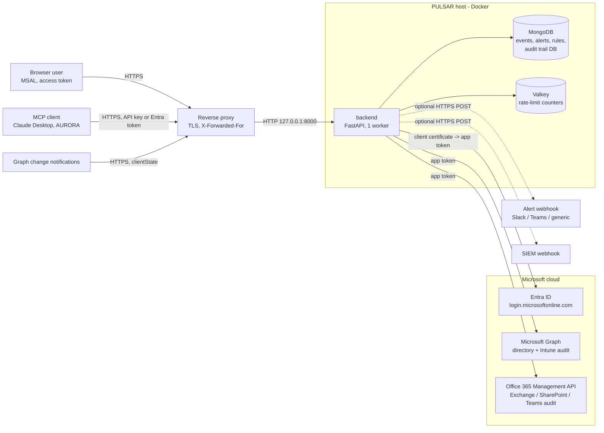

# PULSAR threat model

Scope: the PULSAR code and a standard deployment (`docker-compose.prod.yml` behind a TLS-terminating reverse proxy).
A deployment serves one tenant; there is no multi-tenant mode, so each client gets its own instance and data store.

## 1. System and data flow

Trust boundaries: (1) internet to reverse proxy, (2) proxy to backend, (3) backend to data stores (internal network
only), (4) backend to Microsoft and to the two optional webhooks, (5) browser to its own page (the UI loads Alpine and
MSAL from two pinned CDN paths).

Two Entra app registrations keep the powerful credential away from the user-facing one:

- **Ingestion app** - application permissions `AuditLog.Read.All`, `DeviceManagementApps.Read.All`,
  `ActivityFeed.Read`; authenticates with a certificate whose private key never leaves the server; no redirect URIs.
- **API app** - defines app roles, requires assignment, has no credentials and no application permissions.

## 2. Assets

| Asset | Why it matters |
|---|---|
| Audit events (UPNs, IPs, device and group names, admin actions) | Personal data and a map of who administers the tenant |
| Ingestion certificate (key + cert) | Read access to the whole tenant's audit data |
| Audit trail of PULSAR itself | Accountability for what users did in PULSAR |
| Alert rules and webhook URLs | Altering them silences or redirects detection |
| MCP API key, webhook `clientState` | Direct read access / spoofed notifications |

## 3. STRIDE

| Threat | Where | Control | Evidence |
|---|---|---|---|
| **Spoofing** a user | API, UI, MCP | Entra access tokens only (RS256, JWKS, exact issuer, `tid`, audience, required `scp`, required `exp`/`iss`/`aud`); ID tokens rejected; assignment-required app | `test_security.py`: tenant/issuer, ID-token, required-claims tests |
| Spoofing Graph | `/api/webhooks/graph` | Constant-time `clientState` comparison; rejected when no secret is configured | `test_api.py` webhook tests |
| Spoofing a client IP | rate limit, `/metrics` | `X-Forwarded-For` read right to left, only through `TRUSTED_PROXIES` | `test_security.py` XFF tests |
| **Tampering** with events | API | Tag/comment writes are scoped by the privacy filter; events are upserted by dedupe key; admin-only rule changes | route-authorisation test |
| Tampering with the audit trail | MongoDB | App user can only insert into the audit database; a copy goes to stdout first | `deploy/mongo-init`, `audit_trail.py` |
| Tampering in transit | all links | TLS at the proxy; outbound calls HTTPS (SIEM HTTPS-only) | `utils/ssrf.py` |
| **Repudiation** | mutations | One audit record per mutating request: user, action, detail, method, status, request ID (failed and denied attempts included) | `test_security.py` audit tests |
| **Information disclosure** | reads | Privacy-gated services/operations hidden at query level on every read path (REST, MCP, alerts, filter options, summaries); documents without a service are hidden too | `test_security.py` privacy tests |
| Disclosure via errors | API | Generic 500 handler; OpenAPI docs off; webhook and Office 365 errors do not echo upstream bodies | `main.py` |
| Disclosure via alert cards | Slack/Teams | Tenant-controlled names are defanged (`hxxps[:]//`, broken markdown links) | `test_security.py` |
| Secret exposure | containers | Mongo root credentials only in the mongo container; Valkey password in a mounted file; certificate as a Docker secret | `docker-compose.prod.yml` |
| **Denial of service** | API | Redis rate limits per IP (fails closed), bounded page sizes, 10 000-document bulk-tag cap, 5 s DB time limit on counts and aggregations, webhook body limit, 10 MiB upstream response limit | `rate_limiter.py`, `queries.py`, `routes/webhooks.py`, `utils/http.py` |
| **Elevation of privilege** | roles | Admin-only: rule changes and manual fetch; privacy data needs `PRIVACY_SERVICE_ROLES`; MCP API key carries no roles | route-authorisation test pins the admin set |
| SSRF | webhooks, SIEM, Office 365 content | IP-literal and name blocklist, HTTPS-only SIEM with domain allowlist, content URIs limited to Microsoft hosts, redirects disabled | `utils/ssrf.py`, `test_refactor.py` |
| Injection | search, filters | All free text matched literally (`re.escape`), typed request models, no string-built queries | `queries.py`, MCP input tests |
| XSS / script gadgets | UI | CSP without `unsafe-eval`; exact CDN library paths; templates restricted to Alpine's CSP build; CSV export neutralises formulas | `test_frontend_csp.py` |

## 4. Accepted risks and limits

These are known and intentional; an assessor should not be surprised by them.

1. **Tokens in `sessionStorage`.** MSAL keeps the access token in the browser. A successful XSS could read it; the
   CSP and the CSP-only template rules are the mitigation. A server-side session (BFF) would remove this.
2. **`style-src 'unsafe-inline'`.** Needed by inline styles in the UI; scripts are not affected.
3. **Shared MCP API key.** Anyone holding it reads everything not privacy-gated, as the single identity
   `mcp-api-key`. Use Entra sign-in for per-user attribution. Rotate the key regularly.
4. **SSRF by DNS.** Hostnames are not resolved before use, so a public name that points at a private address is not
   caught in code. Redirects are disabled; deployments should also restrict egress at the host or network.
5. **Evidence can be annotated.** Any signed-in reader can add tags and comments to events and change alert status.
   Annotations have no history (the audit trail records who did it). Restrict `AUTH_ALLOWED_ROLES` accordingly.
6. **Audit-trail writes fail open.** If MongoDB is unreachable the action still proceeds and a warning is logged; the
   stdout copy remains. Ship container logs to a log system you control.
7. **No TLS inside the Docker network.** MongoDB and Valkey are reachable only on an internal network but speak
   plaintext; the host's isolation is the control.
8. **Search cost.** Free-text search is an unanchored case-insensitive regex; counts and aggregations are time-limited,
   the event list query is not. Rate limiting bounds how often it can be run.
9. **One worker.** MCP SSE sessions live in process memory, so the service is not horizontally scaled.
10. **Unauthenticated endpoints** by design: `/health`, `/metrics` (IP allowlist), `/api/version`,
    `/api/config/*` (public client identifiers), `/api/webhooks/graph` (`clientState`).

## 5. What the test suite proves

`backend/tests/test_security.py` covers token validation, role and privacy enforcement on every read path, audit
attribution, X-Forwarded-For handling, MCP input bounds, alert-card defanging, certificate client assertion, startup
refusal rules and a route-by-route check that every `/api` route requires authentication (with the public list
pinned). `test_frontend_csp.py` pins the CSP and template rules.
